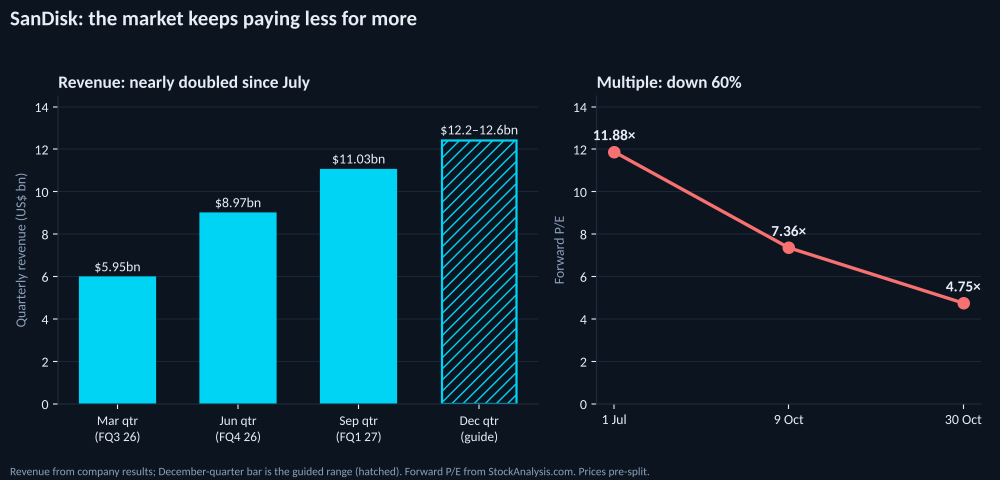

  📄 <strong>Companion research note:</strong> This is the second follow-up to <a href="/post/2026-07-02-investing-in-the-ai-boom">Investing in the AI Boom</a> (2 July 2026), after <a href="/post/2026-10-12-investing-in-the-ai-boom-three-months-on">The Shortage Held. The Trade Didn't</a> (12 October 2026). Prices are closing prices on Friday 30 October 2026 unless stated; the comparison points are the 9 October close used in the last update and the 1 July close used in the original. SanDisk prices are before its eight-for-one split, which takes effect on 20 November. Apple reported after the US close on Monday 2 November; its results are included, but its share price in the tables is still the 30 October close. NVIDIA reports on 17 November and is not included. Figures come from company filings, StockAnalysis.com and the reporting cited at the bottom. This is a research and educational piece, not investment advice, and I am not a licensed financial advisor.

---

## Download this essay as a PDF

The second scorecard as a printable essay: what seven of the nine companies reported, why every one of them fell anyway, how the signposts from the last update scored, and what the market is now pricing into the memory names.

  <strong style="font-size: 1.08em;">📄 Aggarwal N. <em>Beat, Raise, Sell: Investing in the AI Boom After the Third-Quarter Results.</em> 2026.</strong>
    
  <a href="/static/Investing-in-the-AI-Boom-After-Q3.pdf" style="background: white; color: #0D1B2A; padding: 0.5em 1.2em; border-radius: 4px; font-weight: bold; text-decoration: none; display: inline-block; margin-top: 0.3em;">⬇ Download PDF (608 KB, 16 pages, 3 figures)</a>

---

On 12 October I ended with a calendar. "The next three weeks," I wrote, "will tell us more than the last three months." I listed the results I was waiting for and, for most of them, the number that would matter: Western Digital's gross margin against its 55–56% guide, SanDisk against its $10.3–10.8 billion revenue guide, FormFactor against roughly $270 million, TSMC's outlook, Intel's foundry losses.

Those results are now in for seven of the nine companies, and they told us a great deal about the companies. Almost every number I said would matter came in on the right side of the line, several of them by a wide margin.

The short version: **the companies beat, they raised, and the market sold.** All seven reporters beat on the quarter. Of the six whose guidance I could compare with consensus, four guided above it, Apple guided above on revenue and below on margin, and Intel guided far below. All seven fell: six on their next trading day, and Apple by about 2.6% in after-hours trading on Monday. The equal-weighted basket of the nine is down **15.2%** since 9 October and **18.9%** since 1 July. The semiconductor ETF has fallen 13.4% since 9 October and is now roughly 12% below its 2 July level, so the basket is still trailing the sector, but no longer by much: this time almost everything went down together.

---

## 1. The scorecard

  
  
Change since the 1 July close, as it stood at the last update (hollow) and now (filled). Only Apple and Texas Instruments moved up. FormFactor, SanDisk and Intel lost more in three weeks than in the previous three months.

| Company | Ticker | 1 Jul | 9 Oct | 30 Oct | Since 9 Oct | Since 1 Jul | Avg. target now | Implied upside |
|---|---|---|---|---|---|---|---|---|
| Apple | AAPL | $294.38 | $336.64 | $344.63 | **+2.4%** | **+17.1%** | $332.39 | −4% |
| Texas Instruments | TXN | $285.48* | $283.74 | $300.84 | **+6.0%** | **+5.4%** | $336.86 | +12% |
| NVIDIA | NVDA | $197.58 | $229.28 | $204.64 | **−10.7%** | **+3.6%** | $328.95 | +61% |
| TSMC | TSM | $445.12 | $453.31 | $406.13 | **−10.4%** | **−8.8%** | $584.39 | +44% |
| Micron | MU | $1,032.28 | $1,029.00 | $884.74 | **−14.0%** | **−14.3%** | $1,561.91 | +77% |
| Western Digital | WDC | $598.37 | $397.28 | $366.11 | **−7.8%** | **−38.8%** | $613.38 | +68% |
| FormFactor | FORM | $152.54 | $139.67 | $87.53 | **−37.3%** | **−42.6%** | $152.22 | +74% |
| SanDisk | SNDK | $2,032.22 | $1,581.82 | $1,150.89 | **−27.2%** | **−43.4%** | $2,105.29 | +83% |
| Intel | INTC | $127.02 | $104.70 | $65.76 | **−37.2%** | **−48.2%** | $107.21 | +63% |

*TXN from the 29 June close, as in the original piece. Targets are the average of covering analysts on StockAnalysis.com in the last week of October; the FormFactor and Texas Instruments figures were last refreshed on 27 October.*

Three things stand out.

**The ranking held, and the gaps widened.** Apple and Texas Instruments, the two least AI-dependent businesses in the group, are the only two that rose. The four memory-linked names fell by an average of 21.6% in three weeks and are now down 34.8% on average since July.

**Western Digital was the best of the memory names**, down 7.8%, after being the worst in the last update. That is not a recovery: it is a stock that had already fallen 34% meeting a sector that was catching up.

**The analysts did not move, and the gap to their targets is now enormous.** Average targets are within a few percent of where they were on 9 October, except Intel's and Western Digital's, which fell about 9%. SanDisk now trades 83% below its consensus target, Micron 77% below. A gap that size is not a disagreement about a few quarters of earnings. It is a disagreement about whether the earnings exist in 2028.

---

## 2. Beat, raise, sell

Here is the earnings season in one table. "Next day" is the first full trading session after each release; I include the semiconductor ETF's move on the same day, because on two of those days the whole sector fell 6–7%, and a company's own reaction is hard to separate from that.

| Company | Reported | Quarter vs expectations | Next quarter's guide | Next day | SMH same day |
|---|---|---|---|---|---|
| TSMC | 15 Oct | Revenue $46.7bn, +41% (US$); gross margin 66.4% | $52.3–54.3bn; GM 65–67% | **−1.8%** | −1.0% |
| Texas Instruments | 21 Oct | Revenue $6.06bn, +28%; EPS $2.62 vs $2.42 est. | $5.80–6.30bn; EPS $2.45–2.79, midpoint above consensus | **−1.8%** | −6.0% |
| Western Digital | 22 Oct | Revenue $4.38bn, +55%; GM 57.8% vs 55–56% guide | $5.1bn; GM 60–61%; well above consensus | **−3.0%** | +0.7% |
| FormFactor | 28 Oct | Revenue $280.5m, +38%; non-GAAP EPS $1.04 | $285m; EPS $0.95 vs $0.80 consensus | **−11.7%** | −1.1% |
| Intel | 29 Oct | Revenue $16.5bn, +21%; non-GAAP EPS $0.52 | $15–16bn vs ~$17.1bn; GM 38% vs ~42.8% | **−28.6%** | −7.0% |
| SanDisk | 29 Oct | Revenue $11.03bn, +378%; GM 85.0% vs $10.3–10.8bn guide | $12.2–12.6bn; EPS $55–57 vs $54.69 consensus | **−13.5%** | −7.0% |
| Apple | 2 Nov | Revenue $114.5bn, +12%, vs $113.4bn est.; EPS $2.10 vs $1.99 | Revenue +7–10% vs ~5.9% consensus; GM 45–46% vs ~47% | **≈ −2.6%** after hours | — |

Three of those rows are not like the others. Intel's guide was a genuine miss, and its fall is the most important single event of the three weeks, for reasons I come to in section 4. The SanDisk and FormFactor results were beats with a qualifier attached, and the market priced the qualifier rather than the beat. And Apple's was a beat whose qualifier was the same one Intel had reported three days earlier: memory.

The other memory makers that reported told the same story from outside the US. **Samsung** posted a record operating profit of 107.4 trillion won on 29 October, up 783% on the year, but its chip division's profit of 106.5 trillion won fell short of some estimates of around 110 trillion, and its shares fell 6.6% that morning. **Kioxia**, SanDisk's manufacturing partner, reported on 30 October and guided to flat revenue and flat operating profit for the December quarter, saying its average selling prices would rise only "modestly". Bloomberg's summary — that Kioxia had warned the AI-driven surge in flash prices was fading — landed a few hours before the US open, on the morning after SanDisk's results.

---

## 3. The memory names: every signpost passed

### SanDisk (SNDK): −27.2% since 9 October, −43.4% since 1 July

SanDisk's fiscal first quarter was better than its own guidance on every line. Revenue was **$11.03 billion**, up 23% on the previous quarter and 378% on the year, against a guide of $10.3–10.8 billion. The gross margin was 85.0%. Non-GAAP earnings were $49.51 a share against a $44–46 guide. Datacenter revenue rose 61% in a single quarter, to $4.8 billion, which is nearly eighteen times what it was a year ago. The company bought back $5 billion of its own stock in the quarter and announced an eight-for-one split. Guidance for the December quarter is $12.2–12.6 billion at a gross margin of 84.5–85.5%.

The stock fell 13.5% the next day and about 18% over two sessions. The forward price-to-earnings ratio, which I described in the last update as falling from 11.9 to 7.4, is now **4.75**.

  
  
Quarterly revenue has nearly doubled since the July piece. The multiple the market will pay for next year's earnings has fallen by 60%.

The qualifier was in the composition of the growth. According to TIKR's analysis of the call, pricing drove about two-thirds of the previous quarter's 51% sequential revenue growth, but only about 9 percentage points of this quarter's 23%, and management guided to only "modest" price increases from here. Consumer revenue fell 29% in the quarter, to $397 million, which is the first visible sign that high flash prices are pricing some buyers out. And SanDisk expects its March quarter to be seasonally weak.

There was also a stronger point on the other side, which the share price ignored. Long-term agreements now cover about half of SanDisk's fiscal 2027 bit output and two-thirds of fiscal 2028, according to the same analysis; in late July, analysts were describing coverage of "just over a third" of fiscal 2027. Contracts fix volume more than they fix price, so this does not settle the argument. But it is the opposite of what a company about to face a demand collapse usually reports.

### Western Digital (WDC): −7.8% since 9 October, −38.8% since 1 July

This is the result I said would matter most. Three weeks ago I wrote that Western Digital's gross margin was the number to watch, and that "a print below 55% would be the first sign that pricing is softening." It printed **57.8%** on a GAAP basis and 58.1% non-GAAP, against a 55–56% guide. Revenue was $4.38 billion, up 55%, against the $4.1 billion guide. The December-quarter guide is $5.1 billion, up 66–72% on the year, at a gross margin of **60–61%**, with earnings of about $5.80 a share. The dividend went up 17%. The chief financial officer credited "robust exabyte growth and improved pricing".

The signpost passed by more than two points, and the guide implies the margin keeps rising. The stock fell 3% the next day, rallied 15% over the following three sessions, and gave back about half of that on 30 October, when the whole memory group sold off after SanDisk and Kioxia. It is now about 54% below its June high.

I should be honest about what this means for my method. I chose the gross margin as the signpost because it was the cleanest test of whether hard-drive pricing was holding against the threat of Toshiba's new capacity. It is holding. The market's response suggests that the price of Western Digital's stock is not, right now, set by Western Digital's gross margin.

### Micron (MU): −14.0% since 9 October, −14.3% since 1 July

Micron did not report: its fiscal first quarter ends in late November and it reports in December. Its stock fell with the group anyway, and it had two stories of its own.

The first was labour. At Micron's Taiwan operations, the Taichung union reached an agreement on 21 October that included a new quarterly profit-sharing bonus, salary adjustments, higher shift allowances and a higher pension contribution. The Taoyuan union did not: eleven of its officials held a token 24-hour strike on 22 October, which the union said was not intended to disrupt production, and on 23 October about 70% of its 2,300-plus members voted to reject Micron's profit-sharing proposal. Talks were due to resume on 27 October; I have not found a report of the outcome. So far this is a story about who shares in record profits, not about lost output.

The second was the read-across from Samsung and Kioxia. Micron trades at about five times forward earnings, with a Strong Buy consensus from 49 analysts and an average target 77% above the price. Five times earnings is a multiple usually reserved for companies whose profits are expected to fall sharply, and it fell 5.3% on 30 October without any news of its own.

### FormFactor (FORM): −37.3% since 9 October, −42.6% since 1 July

FormFactor's third quarter was a record: revenue of $280.5 million, up 38% on the year and above the roughly $270 million guide, a non-GAAP gross margin of 56.5% and earnings of $1.04 a share. December-quarter guidance of $285 million and $0.95 a share was above the Zacks consensus of $278.8 million and $0.80.

The stock fell 11.7% the next day and another 10.2% on 30 October. Three things in the detail explain it. **Growth is slowing because the factory is full**: guidance implies 1.6% sequential growth after 8.6%, and management said productivity gains from the existing footprint are moderating as it nears capacity. **The new capacity will cost margin before it adds revenue**: the Farmers Branch plant, which should reach about $400 million of annual probe-card capacity by the end of 2027, carries $25–30 million of pre-production costs, and management put 2027's non-GAAP gross margin at around 53%. And **HBM probe-card revenue fell sequentially** because of product-mix changes at customers — in a year in which HBM was the reason to own the stock.

In July I called FormFactor the most "picks and shovels" company in the group. It is a better business now than it was then. It is also a capacity-constrained one, and the market has stopped paying for growth it cannot ship.

---

## 4. The rest of the stack

### Intel (INTC): −37.2% since 9 October, −48.2% since 1 July

Intel's third quarter was good. Revenue rose 21% to $16.5 billion; data-centre and AI revenue rose 78% to $7.3 billion; non-GAAP earnings more than doubled to $0.52 a share; and, after two quarters of large GAAP losses driven by mark-to-market charges on the shares escrowed under the US government agreement, it posted GAAP net income of $3.3 billion, helped by a $1.0 billion gain on the same line. The foundry business lost another $1.9 billion on revenue of $6.7 billion.

The guidance was not good. Intel guided to $15–16 billion of fourth-quarter revenue against about $17.1 billion expected, a non-GAAP gross margin of **38%** against about 42.8%, and non-GAAP earnings of $0.25 against about $0.43. The stock fell **28.6%** on 30 October, which reports placed among its worst days since 1974.

The reason is the most important single fact of the earnings season for this series. Intel now expects the PC market to shrink **12% in 2026 and 10% in 2027**, and it blames memory: suppliers have moved capacity to high-bandwidth memory for AI, conventional DRAM for PCs has become scarce and expensive, and PC makers have cut their orders. The chief financial officer said the slowdown would last "at least through the first half of next year". Data-centre revenue was separately held back by raw-material shortages and a factory shutdown in Israel.

In July I described Apple as "the AI boom's biggest customer, not its biggest winner" — the company being squeezed by its memory suppliers. Intel is the same story one step further down the chain. **The shortage that makes SanDisk and Micron so profitable is now visibly destroying demand in the markets that buy conventional memory.** That is how commodity cycles usually end: not with a sudden flood of supply, but with demand at the margin giving up first.

### TSMC (TSM): −10.4% since 9 October, −8.8% since 1 July

TSMC did everything a long-term holder could ask. Third-quarter revenue was $46.7 billion, up 41% in US dollars, at a gross margin of 66.4% and an operating margin of 58.7%; net income rose 69%. Two-nanometre wafers were already 8% of wafer revenue, and 7nm-and-below 79%. December-quarter guidance is $52.3–54.3 billion — about 14% sequential growth at the midpoint — at a 65–67% gross margin. Capital spending for 2026 is unchanged at $60–64 billion, and the chief financial officer said spending over 2026–2028 would "significantly" exceed the previous three years. C.C. Wei described demand as "extremely strong" with "no signs of slowing", and said AI accelerator revenue would "probably" grow faster than the mid-to-high-50s compound rate TSMC has forecast to 2029. His one note of caution was about consumer and price-sensitive markets in 2027 — the same markets Intel was describing.

The stock is down 10% in three weeks. Nothing in TSMC's own numbers explains that. The sector does.

### NVIDIA (NVDA): −10.7% since 9 October, +3.6% since 1 July

NVIDIA has not reported; its fiscal third quarter ended on 25 October and results are due on **17 November**. The stock has given back most of its gain since July and now trades at about 17 times forward earnings, against an average target 61% higher. Last time I wrote that I had been too quick to call it fully priced. Three weeks later it fell as far as TSMC on no news of its own. Whatever the market is pricing in October, it is not distinguishing much between the companies whose products have substitutes and the ones whose products do not.

### Texas Instruments (TXN): +6.0% since 9 October, +5.4% since 1 July

The best performer of the three weeks. Third-quarter revenue rose 28% to $6.06 billion, ahead of the $5.91 billion consensus, operating profit rose 73% as the move to 300-millimetre wafers continued to pay off, and earnings of $2.62 a share beat by about 8%. The December-quarter guide of $5.80–6.30 billion is roughly flat sequentially at the midpoint, in what is usually a seasonally weaker quarter. The release does not discuss the analog price increases I mentioned in the last update, so I cannot yet say whether they are showing up. The stock fell 1.8% on the day after results — the same day the semiconductor ETF fell 6% — and then rose to a level above where it started.

### Apple (AAPL): +2.4% since 9 October, +17.1% since 1 July — then about −2.6% after its results

Apple reported on Monday evening, in John Ternus's first earnings call as chief executive. By the measures Wall Street had set, it was a clean beat. Revenue was a September-quarter record of **$114.5 billion**, up 12%, against about $113.4 billion expected; earnings were $2.10 a share against $1.99. **iPhone revenue rose 17% to $57.6 billion**, about $1 billion above consensus, on a record year for upgraders and only eight days of iPhone 18 Pro sales in the quarter. Mac revenue rose 24%. Services grew 10% to a record $31.6 billion, in line. Greater China grew 21% but still missed estimates by about $1.2 billion. For the full fiscal year, revenue was $478.8 billion, up 15%.

The guidance for the December quarter was the more interesting half. Apple expects revenue growth of 7–10% — above the roughly 5.9% consensus — which it says would be its best quarter ever, "which reflects our best view of constrained supply". It expects a gross margin of **45–46%**, against about 47% expected and 47.9% in the September quarter. Chief financial officer Kevan Parekh attributed the decline to "higher memory costs, as well as some costs related to the ramp of Siri AI", and Apple said most of the expected margin decline was due to memory. It called memory pricing "unprecedented", said the constraints on Mac and iPad in the December quarter were driven mainly by memory, and reported that its manufacturing purchase obligations had risen by $33 billion since June. Strip out the tariff refunds that flattered the September quarter and the gross margin was already about 46.9%. The shares fell about 2.6% in after-hours trading.

Put that next to Intel and the memory makers, and the season resolves into one picture. **Apple is not losing demand. It is losing margin and volume to memory.** It could sell more iPhones, Macs and iPads than it can build, and the binding constraint is the same component SanDisk, Micron and Western Digital are being paid record prices for. Intel described the same mechanism from the other side: PC makers who cannot get affordable memory are cutting orders. In July I called Apple "the AI boom's biggest customer, not its biggest winner". The September quarter is the first in which a customer of that size has said, in its own guidance, that memory is now the ceiling on what it can ship. That is good news for memory pricing this quarter — and exactly the kind of demand damage that ends a shortage later.

Apple remains the only one of the nine trading above its average analyst target, and at about 36 times next year's expected earnings, according to Oppenheimer, it is priced as the quality compounder of the group. That is why a one-point margin shortfall cost it more than the record revenue earned it.

---

## 5. Why the stocks fell anyway

Three things moved these stocks in October, and only one of them was in the earnings releases.

**The cost of money.** The ten-year US Treasury yield stood at 5.24% on 9 October, according to AP's market data, and inflation figures released in the week of 12 October showed both consumer and producer prices accelerating. Chip stocks fell for eight straight sessions to 16 October, the sector's longest losing streak since 2008, and Reuters reported that US chip stocks were on course to lose about $2 trillion of market value amid rising bets on an interest-rate increase. The Federal Reserve held rates at 3.75–4% on 28 October. Yields eased to about 5.0% by 23 October, but a company priced on its 2028 earnings is worth less when money costs 5% than when it costs 4%, whatever it reports for September.

**Doubt about who pays for the buildout — alongside evidence that they are still paying.** On 22 October, the day after Meta reported, the Philadelphia Semiconductor Index fell 6.7%, its biggest one-day fall since June, and the Nasdaq had its worst day since early June; Reuters attributed it to earnings that "revived doubts about AI spending". Reports through the month focused on the financing side: debt-funded AI infrastructure companies facing higher borrowing costs, CoreWeave falling 12% in a day on 16 October, and Meta's first quarterly cash outflow in more than a decade. And yet the spending data say the opposite. Business Insider's tally on 30 October put third-quarter capital spending by the five largest spenders at about **$227 billion**, up roughly 20% on the second quarter, and full-year 2026 spending at $803–828 billion. Amazon said 2027 spending would be "meaningfully more"; Alphabet said "significantly" higher. Microsoft cut its 2026 figure to about $170 billion, but because third-party data-centre capacity was late, not because it wanted less. The market is not pricing a fall in AI spending. It is pricing the risk that the spending is being financed in a way that will not last.

**The second derivative of memory prices.** This, I think, is the one that matters most for the memory names, and it is visible in one chart.

  
  
Prices have not fallen. The rate at which they rise has gone from doubling every quarter to a few per cent. For a stock priced on the peak of the cycle, that is the signal that matters.

Memory prices are still rising. TrendForce's latest forecasts, from 30 September, have conventional DRAM contract prices up another 10–15% this quarter and NAND up 15–20%. But a year ago the story was prices doubling in a quarter, and Kioxia's own average selling price has gone from "more than doubled" to about 70% to the mid-20s and now to "modest". Kioxia's president told Bloomberg in September that "prices have already risen enough", and the company is moving its pricing towards stability rather than spikes. In past memory cycles, the peak in the rate of price increases has tended to come before the peak in profits, often by several quarters. The market is not waiting for the profits to turn. It is selling the deceleration.

The three forces compound each other. A memory company's 2026 earnings are not in dispute. Its 2028 earnings depend on whether prices hold after this wave of capacity arrives, and the value of 2028 earnings today depends on the interest rate. In October the market cut its estimate of the first and raised the second at the same time.

---

## 6. The signposts, scored

Here is the table from the last update, with the results filled in.

| Date | Event | What I said would matter | What happened | Stock |
|---|---|---|---|---|
| 15 Oct | TSMC Q3 | Capex guidance and Q4 AI outlook | Capex held at $60–64bn; Q4 guide +14% QoQ; "no signs of slowing" | ✓ passed, −10% |
| 21 Oct | Texas Instruments Q3 | Analog price increases in the Q4 guide | Beat; Q4 guide flat QoQ, firm for the season; pricing not discussed in the release | ✓ mostly, +6% |
| 22 Oct | Western Digital FQ1 | Gross margin vs 55–56%; below 55% = pricing softening | 57.8%; guided to 60–61% | ✓ passed, −8% |
| 28 Oct | FormFactor Q3 | HBM probe-card demand vs ~$270m guide | Revenue $280.5m; but HBM probe-card revenue fell QoQ and the factory is near capacity | ½, −37% |
| 29 Oct | Intel Q3 | Foundry losses; Terafab or external 18A customers | Foundry lost $1.9bn; no Terafab news; Q4 guide far below consensus | ✗, −37% |
| 29 Oct | SanDisk FQ1 | Whether the $10.3–10.8bn guide held | $11.03bn; guided to $12.2–12.6bn | ✓ passed, −27% |
| 2 Nov | Apple FQ4 | iPhone 18 demand and memory costs | iPhone +17% despite supply limits; December-quarter margin guided down to 45–46%, mostly on memory | ½, ≈ −2.6% after hours |
| 17 Nov | NVIDIA Q3 FY27 | Delivery against the ~$108bn guide | Reports 17 Nov | — |
| Ongoing | Supply side | CXMT, Toshiba, Micron Taiwan labour | Taichung deal; Taoyuan rejected; no major new supply news I could confirm | — |

Of the seven signposts that have reported, four passed or mostly passed, two half-passed and one failed. The four that passed — TSMC, Texas Instruments, Western Digital and SanDisk — have moved by −10% on average since 9 October.

That is a result about my method as much as about the market. I chose signposts that tested whether the fundamentals were holding, on the reasonable assumption that over three weeks, earnings season would be about earnings. It wasn't. The fundamentals held almost everywhere and the stocks were moved by the rate of change in memory prices, by bond yields and by doubts about how AI infrastructure is being financed — none of which was on my table. A signpost that passes while the stock falls 27% is not a useful signpost for the stock.

---

## 7. What I got wrong this time

In the last update I listed three errors from July. Three weeks later I can add three more, smaller but more specific.

**I set the right tests for the businesses and the wrong tests for the shares.** The memory stocks have been trading for four months on when the cycle turns, and I had already said so. I then picked signposts that measured where the cycle is, not where it is going. The single most predictive number of the three weeks was not in any of the results I listed: it was Kioxia's word "modest".

**I took too much comfort from the non-memory names.** I wrote that TSMC, Texas Instruments and NVIDIA had held up because their positions did not depend on the next fab. In three weeks TSMC and NVIDIA each fell 10% on no bad news of their own. When the sector sells off on rates and financing, the distinction between a toll-taker and a commodity seller matters much less than I suggested. Texas Instruments held — but it is the least AI-dependent company in the group, which is not quite the lesson I drew.

**I underweighted the customer side of the shortage.** Both earlier pieces mentioned that Apple was being squeezed by memory costs. I treated that as a story about Apple's margin. Intel has now said that the same costs are shrinking the PC market by a tenth a year for two years, and Apple has said that memory is now limiting how many Macs, iPads and iPhones it can build. That matters for the memory makers in two ways: it is lost volume, and it is the mechanism by which a shortage ends without anyone adding a single fab.

---

## 8. What I am watching next

| Date | Event | What would matter |
|---|---|---|
| **17 Nov** | NVIDIA Q3 FY27 | Delivery against roughly $108bn and the January-quarter guide; any comment on customer financing |
| **20 Nov** | SanDisk split | Split-adjusted trading begins; mechanically irrelevant, sometimes not for flows |
| **Late Dec** | TrendForce Q1 2027 contract-price forecasts | The first full read on 2027 DRAM and NAND pricing; a flat or negative DRAM forecast would be the turn |
| **Dec** | Micron FQ1 2027 | Delivery against the ~$61.5bn guide; HBM4 pricing; Taiwan labour costs |
| **Dec** | Federal Reserve | Whether the rate-increase bets that drove October come back |
| **Ongoing** | PC and smartphone units | Further evidence, after Intel, that memory prices are destroying demand at the margin |

The signpost I would now weight most heavily is the first one in the TrendForce calendar for 2027. Everything in the memory names hangs on whether contract prices are still rising in the first half of next year. If they are, the stocks are pricing a downturn that has not arrived. If they flatten, the market was right to leave early.

---

## 9. Where I land now

The July piece made an industry argument and a stock argument. The October update said the industry argument had been confirmed and the stock argument had not. This round makes that sharper.

The industry argument has now been confirmed by every round of results since the July piece, from every memory company that reported, on every operating measure, with guidance that is still going up. SanDisk will very probably earn more next quarter than it did last quarter. So will Western Digital. Micron has guided to its largest quarter ever.

The stock argument is now explicitly priced in the opposite direction. SanDisk at under five times forward earnings and Micron at about five are pricing a fall in profits large and soon enough that next year's earnings estimates are wrong. The evidence in favour of that view is real: price increases are decelerating sharply, the shortage is visibly costing the customers volume, capacity is being added in Japan, China and elsewhere, and money now costs 5%. The evidence against it is also real: long-term agreements now cover half to three-quarters of next year's output at SanDisk and Micron, hyperscaler spending is still rising, and prices have not yet fallen anywhere.

I do not know which way that resolves, and I no longer think the quarterly results will tell us in advance. The prices will. What I can say is that the bet is now very clearly defined. Anyone holding the memory names is betting that contract prices keep rising, however slowly, through the first half of 2027, against a market that has decided they will not. That is a defensible bet at these valuations. It is not the bet I described in July, when I called the pullback "the entry point", and the people who acted on that call are now down 35% on the four memory names on average. That deserves to be said again plainly.

*This article is a research and educational summary and does not constitute investment advice, and I am not a licensed financial advisor. It is not a recommendation to buy or sell any security. Readers should consult a licensed financial advisor and do their own due diligence before making investment decisions. Past performance, including the moves described here in both directions, is not indicative of future results.*

---

## References and Further Reading

**Prices, fundamentals and consensus targets**
- StockAnalysis.com — [SNDK](https://stockanalysis.com/stocks/sndk/), [WDC](https://stockanalysis.com/stocks/wdc/), [MU](https://stockanalysis.com/stocks/mu/), [NVDA](https://stockanalysis.com/stocks/nvda/), [TSM](https://stockanalysis.com/stocks/tsm/), [INTC](https://stockanalysis.com/stocks/intc/), [FORM](https://stockanalysis.com/stocks/form/), [TXN](https://stockanalysis.com/stocks/txn/), [AAPL](https://stockanalysis.com/stocks/aapl/), [SMH](https://stockanalysis.com/etf/smh/history/) — closing prices to 30 October 2026, forward P/E, analyst consensus
- [Google Finance — TXN](https://www.google.com/finance/quote/TXN:NASDAQ) and [StockScan — FORM price history](https://stockscan.io/stocks/FORM/price-history) — 30 October closes for Texas Instruments and FormFactor

**Company results**
- TSMC — [Third-quarter 2026 results](https://pr.tsmc.com/english/news/3346), 15 October 2026; XenoSpectrum — [TSMC Q3 2026 margins and capex](https://xenospectrum.com/en/tsmc-q3-2026-gross-margin-capex/)
- Texas Instruments — [Q3 2026 earnings release (Form 8-K)](https://www.sec.gov/Archives/edgar/data/0000097476/000009747626000165/q32026txnex99-eredgar.htm), 21 October 2026; 24/7 Wall St. — [TI Q3 2026 against estimates](https://247wallst.com/cards/texas-instruments-q3-2026-earnings-txn-01m5g1n6r3j45hcsgta6qbhjgw)
- Western Digital — [Fiscal first quarter 2027 results](https://westerndigital.com/company/newsroom/press-releases/2026/2026-10-22-wd-reports-fiscal-first-quarter-2027-financial-results), 22 October 2026; GuruFocus — [WDC shares slip after strong Q1](https://www.gurufocus.com/news/9137790/western-digital-wdc-shares-slip-after-strong-q1-results-despite-bullish-outlook)
- FormFactor — [2026 third-quarter results](https://capital.com/en-ae/news/formfactor-inc-reports-2026-third-quarter-results), 28 October 2026; Zacks via TradingView — [FORM drops 12% post Q3 earnings](https://www.tradingview.com/news/zacks:c0bb7bd75094b:0-form-drops-12-post-q3-earnings-should-you-buy-the-stock-on-the-dip/)
- Intel — [Third-quarter 2026 results](https://www.intc.com/news-events/press-releases/detail/1786/intel-reports-third-quarter-2026-financial-results), 29 October 2026; Tech Insider — [Intel plunges on Q4 guidance and PC slump](https://tech-insider.org/intel-plunges-25-q4-guidance-15-16-billion-pc-slump-2026/)
- Sandisk — [Fiscal first quarter 2027 results](https://investor.sandisk.com/news-releases/news-release-details/sandisk-reports-fiscal-first-quarter-2027-financial-results), 29 October 2026; TIKR — [Sandisk sinks 13% after a beat](https://www.tikr.com/blog/sandisk-sinks-13-last-friday-after-a-beat-kioxia-says-the-flash-price-surge-is-fading); 24/7 Wall St. — [Sandisk, Western Digital, Seagate and Micron fall](https://247wallst.com/investing/2026/10/30/sandisk-sinks-9-despite-earnings-beat-raised-guidance-and-8-for-1-split-western-digital-tumbles-8-seagate-slides-7-micron-falls-6/)
- Kioxia — XenoSpectrum, [Kioxia guidance, the yen and NAND prices](https://xenospectrum.com/en/kioxia-guidance-yen-nand-price/), 31 October 2026
- Samsung — IBTimes Australia, [KOSPI falls as Samsung chip earnings disappoint](https://www.ibtimes.com.au/kospi-falls-samsung-chip-earnings-disappoint-1877574); Korea Times, [Seoul stocks after Samsung earnings](https://www.koreatimes.co.kr/economy/20261029/seoul-stocks-down-3-late-thursday-morning-after-weaker-than-expected-samsung-earnings), 29 October 2026
- Apple — MacRumors, [Apple reports 4Q 2026 results](https://www.macrumors.com/2026/11/02/apple-4q-2026-earnings/), 2 November 2026; SiliconANGLE, [Apple's stock drops as new CEO John Ternus delivers his first earnings call](https://siliconangle.com/2026/11/02/apples-stock-drops-as-new-ceo-john-ternus-delivers-his-first-earnings-call/); TheStreet Pro, [Apple tops estimates but shares fall after hours on poor margin guidance](https://pro.thestreet.com/trade-ideas/apple-tops-estimates-but-shares-fall-after-hours-on-poor-margin-guidance); Six Colors, [Apple's Q4 2026 earnings call transcript](https://sixcolors.com/post/2026/11/hello-everyone-its-john-apples-q4-2026-earnings-call-transcript/)
- NVIDIA — [Conference call for third-quarter results](https://nvidianews.nvidia.com/news/nvidia-sets-conference-call-for-third-quarter-financial-results-6928873), 28 October 2026

**Market events**
- Kitco / Reuters — [US chip stocks set to wipe out $2 trillion after latest selloff](https://www.kitco.com/news/off-the-wire/2026-10-15/us-chip-stocks-set-wipe-out-2-trillion-after-latest-selloff), 15 October 2026
- 24/7 Wall St. — [Chip stocks fell 8 days in a row, their longest losing streak since 2008](https://247wallst.com/investing/2026/10/17/chip-stocks-just-fell-8-days-in-a-row-their-longest-losing-streak-since-2008/), 17 October 2026
- Trading Economics — [US stocks fall as chip selloff deepens](https://tradingeconomics.com/united-states/stock-market/news/592870), 16 October 2026
- If You Spent — [The October 2026 AI chip sell-off explained](https://news.ifyouspent.com/en/news/october-2026-ai-chip-selloff-explained) (Reuters and AP data for 22–23 October)
- Phemex — [Philadelphia Semiconductor Index plunges 6% as Intel crashes](https://phemex.com/news/article/philadelphia-semiconductor-index-plunges-6-as-intel-crashes-nearly-30-101888), 30 October 2026
- Hargreaves Lansdown / Business Insider — [AI hyperscalers expected to spend $828 billion on capex](https://www.hl.co.uk/news/ai-hyperscalers-are-expected-to-finish-the-year-spending-a-whopping-828-billion-on-capex), 30 October 2026
- Focus Taiwan — [Micron Taoyuan union strike](https://focustaiwan.tw/business/202610220016), 22 October 2026; The Standard — [Micron workers reject bonus proposal](https://www.thestandard.com.hk/china/article/346333/Taiwan-union-says-Micron-workers-reject-bonus-proposal), 23 October 2026

**Memory pricing**
- NextMSC — [DRAM and NAND price tracker, October 2026](https://www.nextmsc.com/industry-deep-dive/dram-nand-price-tracker-quarterly) (TrendForce 2026 contract price forecasts)

**Earlier pieces in this series**
- [Investing in the AI Boom](/post/2026-07-02-investing-in-the-ai-boom), 2 July 2026
- [The Shortage Held. The Trade Didn't: Investing in the AI Boom, Three Months On](/post/2026-10-12-investing-in-the-ai-boom-three-months-on), 12 October 2026
